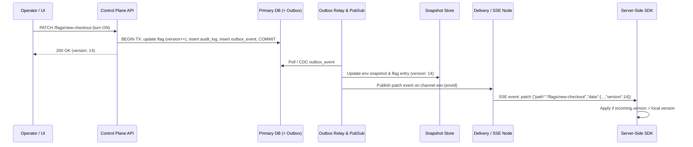

# Flag Delivery Pipeline

This document details how a flag change made by an engineer propagates from the Control Plane to tens of thousands of connected SDKs within milliseconds — reliably, without lost updates, and safely through network partitions.

## End-to-End Propagation Flow

## Consistency & Ordering Guarantees

1. **Transactional Outbox (Zero Dual-Write Bugs)**:
   - Flag mutation, audit log entry, and outbox event are written in a **single ACID database transaction**.
   - Even if the message broker blips, the outbox relay retries publishing until acknowledged.
2. **Monotonic Versioning**:
   - Every flag and segment carries an integer `version` incremented on each write.
   - SDKs and Delivery caches ignore any incoming `patch` or `delete` whose `version <= stored.version`, making at-least-once delivery safe and idempotent.
3. **Tombstones for Deletes**:
   - Deleting/archiving a flag emits a `delete` event carrying the next `version` rather than erasing version history, preventing race conditions between concurrent `put` and `patch` messages.

## Handling Scale Challenges

### 1. Reconnect Storms (Thundering Herd)

When a Delivery Edge node restarts or a customer deploys 500 pods simultaneously:

- **Pre-serialized Snapshots**: Keep each environment's full `put` JSON payload pre-serialized (and pre-gzipped) in the Snapshot Store / memory cache so serving 10,000 simultaneous initial connects does **zero database queries** and minimal CPU work.
- **SDK Jittered Backoff**: All SDKs add randomized jitter to reconnect delays.
- **Relay Proxy Multiplexing**: High-scale customers deploy the Skotos Relay Proxy inside their VPC so 5,000 app instances collapse into 1–2 upstream SSE connections.

### 2. Memory Per Connection

- SSE edge nodes maintain a lightweight `envId -> Set<ClientStream>` subscription map.
- Only one fanout subscription per active `envId` is opened against the Pub/Sub backbone regardless of how many SDK clients connect for that environment.
- Slow consumers with full write buffers are disconnected cleanly rather than letting memory balloon; on reconnect they receive a fresh `put` snapshot.

### 3. Client-Side Stream Fanout

- Browser/mobile SDKs cannot receive raw targeting rules.
- Options for client-side streaming:
  - **Ping-to-Re-evaluate**: Edge sends a lightweight SSE `ping` when any client-side-enabled flag in the environment changes; client SDK re-fetches `/evalx` (CDN-cacheable, simple, low edge CPU).
  - **Targeted Push**: Edge re-evaluates only the changed flag for connected client contexts and pushes the new value directly (lower latency, higher edge memory/CPU).

## Open Questions for Planning

- For client-side streaming in Phase 2, start with **Ping-to-Re-evaluate** (simpler, CDN-friendly) or **direct re-evaluation push**?
- Should Snapshot payloads be stored in Redis, S3/object storage + CDN, or an in-process LRU backed by Redis?
