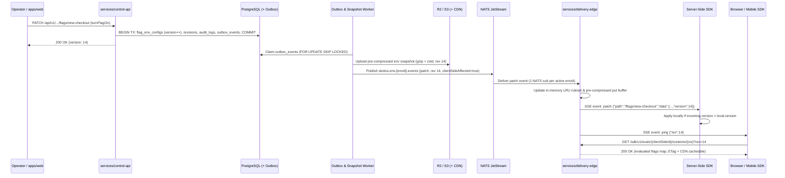

# Flag Delivery Pipeline (Finalized Architecture)

This document defines the exact end-to-end propagation mechanics from a Control Plane mutation to connected Server-Side SDKs, Browser/Mobile SDKs, and VPC Relay Proxies ([ADR-0003](adrs/0003-streaming-and-snapshot-delivery.md)).

## End-to-End Propagation Flow

## Consistency & Ordering Guarantees

1. **Transactional Outbox (Zero Dual-Write Bugs)**:
   - Flag/segment config write, append-only revision snapshot, audit log entry, and `outbox_events` row commit in a **single PostgreSQL ACID transaction**.
   - If R2 or NATS experiences a transient blip, the outbox worker retries with exponential backoff until published.
2. **Monotonic Versioning & Tombstones**:
   - Every flag and segment carries an integer `version` incremented on each mutation; each environment also tracks a monotonic `revision`.
   - SDKs and Delivery Edge caches ignore any `patch` or `delete` where `incoming.version <= stored.version`.
   - Archiving or deleting a flag emits a `delete` tombstone with `version + 1` so stale `put`/`patch` races never resurrect deleted entities.

## Low-COGS Scale Engineering

### 1. High-Density Rust/Tokio SSE Edge (`services/delivery-edge`)

- Each open SSE connection holds only a minimal async channel receiver (~2–4 KB RAM per idle socket), supporting `100k–250k+` concurrent connections on a single modest VM.
- **Single NATS Subscription Per Environment**: Regardless of whether 1 or 50,000 SDK instances connect for an environment, `delivery-edge` maintains exactly **one** subscription on `skotos.env.{envId}.events` and fans out in-process via a `tokio::sync::broadcast` channel.
- **Slow Consumer Protection**: Bounded per-connection broadcast channels drop slow/stalled clients cleanly (triggering automatic SDK reconnect with a fresh `put` snapshot) so memory stays strictly bounded.

### 2. Reconnect Storms & Zero-Egress Snapshots (R2/S3 + CDN)

- Whenever an environment changes, the outbox worker compiles and pre-compresses (`gzip` + `zstd`) the environment ruleset **once** and writes it to **Cloudflare R2** (SaaS, `$0` egress) or S3/MinIO (self-hosted).
- `delivery-edge` caches the pre-compressed `put` bytes in memory; 10,000 simultaneous pod cold starts stream pre-compressed bytes directly without touching PostgreSQL or re-serializing JSON.
- Polling SDKs (`GET /sdk/v1/latest-all`) use strong `ETag` (`"rev-{revision}"`) returning `304 Not Modified` and can sit directly behind CDN edge caches.

### 3. Client-Side MAU Efficiency: Ping-to-Re-evaluate

- Browser/mobile SSE streams (`/stream/v1/eval/{clientSideId}`) do **not** store per-user contexts in edge memory.
- When a client-side-enabled flag changes, `delivery-edge` broadcasts a tiny SSE `ping` (`{"rev":14}`).
- Clients immediately fetch `/sdk/v1/evalx/{clientSideId}/contexts/{base64urlContext}?rev=14` (or `REPORT /sdk/v1/evalx/{clientSideId}/context` for large/sensitive contexts), which runs `crates/skotos-eval` in microseconds on stateless edge nodes and benefits from CDN caching for anonymous/public contexts.
- Server-only flag edits (`clientSideAvailability = false`) do **not** emit client `ping` frames, eliminating unnecessary browser traffic storms.
