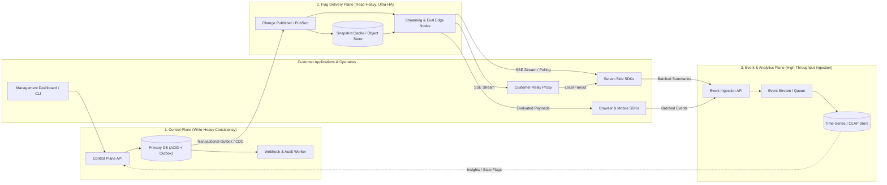

# System Overview

## Architectural Principle: Strict Plane Separation

A production feature flagging platform has **three fundamentally different workload profiles**. Mixing them into a single failure domain is the #1 cause of feature-flag platform outages. Skotos separates the system into three logical (and eventually independently deployable) planes:

## Plane Responsibilities

| Plane                       | Traffic Profile                                                            | Availability Goal                             | Failure Impact                                                                           |
| --------------------------- | -------------------------------------------------------------------------- | --------------------------------------------- | ---------------------------------------------------------------------------------------- |
| **Control Plane**           | Low RPS, complex writes, transactional audit logs, RBAC checks             | `99.9%`                                       | Operators cannot _edit_ flags; existing flags keep evaluating everywhere without impact. |
| **Flag Delivery Plane**     | Very high concurrent SSE connections + read-heavy polling/eval             | `99.99%`                                      | Existing SDKs continue serving cached flags; only _new_ flag edits pause propagation.    |
| **Event & Analytics Plane** | Burst-heavy, massive write volume (millions of evaluations/sec summarized) | `99.9%` (best-effort drop under backpressure) | Dashboard insights/metrics lag; flag evaluation and delivery are 100% unaffected.        |

## Modular Monolith -> Services Evolution Path

To move fast in Phase 1–2 without sacrificing this architecture:

- Start as a **modular workspace** where `control-plane`, `delivery-plane`, `event-plane`, and `eval-engine` have strict internal boundaries and separate storage abstractions.
- Deployable initially as 1–2 containers (plus DB + Redis/NATS) for easy local dev and self-hosting, while cleanly splittable into independently scaled services as load grows.

## Open Questions for Planning

- Which primary backend language fits best for both Control Plane APIs and high-concurrency SSE Streaming nodes (e.g., **Go**, **Rust**, or **TypeScript/Node** + Go streaming edge)? (Track in ADR-0001.)
- What messaging/fanout layer should connect the Control Plane outbox to Delivery nodes (e.g., **Redis Pub/Sub + Streams**, **NATS JetStream**, **Kafka**, or **PostgreSQL LISTEN/NOTIFY** for single-node MVP)? (Track in ADR-0003.)
