# System Overview (Finalized Architecture)

## Architectural Principle: Strict Plane Separation on Ultra-Low-COGS Infrastructure

A production feature flagging platform has **three fundamentally different workload profiles**. Mixing them into a single failure domain is the #1 cause of feature-flag platform outages — and over-provisioning them with heavy managed runtimes is why incumbent platforms charge high per-connection and per-MAU prices.

Skotos runs **Rust (`Axum` + `Tokio`) across all backend planes**, paired with **PostgreSQL 16+**, **NATS JetStream**, **Zero-Egress Object Storage (Cloudflare R2 / S3 / MinIO)**, and **ClickHouse (Phase 4+)**, cleanly separated into three planes:

```mermaid
flowchart LR
    subgraph Clients["Customer Applications & Operators"]
        UI["apps/web SPA (React + Vite + @skotos/ui)"]
        ServerSDK["Server-Side SDKs (TS, Go, Rust, ...)"]
        ClientSDK["Browser & Mobile SDKs"]
        Relay["skotos-relay (Rust Binary in VPC)"]
    end

    subgraph ControlPlane["1. Control Plane (Rust / Axum + ACID Postgres)"]
        ControlAPI["services/control-api (REST + Semantic Patches + utoipa)"]
        Auth["crates/skotos-auth (SaaS External Auth / Self-Hosted Adapter)"]
        PrimaryDB[("PostgreSQL 16+ (Hybrid JSONB + Outbox + Audit + Scheduler)")]
        OutboxWorker["Outbox, Snapshot Compiler & Webhook Worker"]
    end

    subgraph DeliveryPlane["2. Flag Delivery Plane (Rust / Tokio — Ultra-HA, Low COGS)"]
        NATS["NATS JetStream (env.{envId}.events)"]
        R2[("Zero-Egress Object Store (R2 / S3 / MinIO + CDN)")]
        Edge["services/delivery-edge (SSE, ETag Poll, Client evalx)"]
    end

    subgraph EventPlane["3. Event & Analytics Plane (Phased: PG Counters -> ClickHouse)"]
        EventIngest["services/event-ingest (Summary + OTLP Collector)"]
        ClickHouse[("Phase 1-2: PG Rollups / Phase 4+: ClickHouse")]
        ReplayR2[("R2/S3 (Zstd rrweb Replays & Cold Parquet)")]
    end

    UI --> Auth --> ControlAPI
    ControlAPI --> PrimaryDB
    PrimaryDB -- "Transactional Outbox" --> OutboxWorker
    OutboxWorker -- "Pre-compressed Snapshots" --> R2
    OutboxWorker -- "Patch / Delete / Ping Events" --> NATS
    NATS --> Edge
    R2 --> Edge

    Edge -- "SSE put/patch/delete & ETag Poll" --> ServerSDK
    Edge -- "SSE Stream" --> Relay
    Relay -- "Local Fanout" --> ServerSDK
    Edge -- "SSE Ping + CDN-Cached evalx" --> ClientSDK

    ServerSDK -- "5s Gzipped Summaries" --> EventIngest
    ClientSDK -- "Batched Events / Replays" --> EventIngest
    EventIngest --> ClickHouse
    EventIngest --> ReplayR2
    ClickHouse -. "Insights / Guardrails / Experiments" .-> ControlAPI
```

## Plane Responsibilities & SLOs

| Plane                       | Implementation                                                                              | Availability Goal                  | Failure Impact                                                                                           |
| --------------------------- | ------------------------------------------------------------------------------------------- | ---------------------------------- | -------------------------------------------------------------------------------------------------------- |
| **Control Plane**           | `services/control-api` (Rust/Axum) + PostgreSQL 16+                                         | `99.9%`                            | Operators cannot _edit_ flags; existing flags keep evaluating everywhere without impact.                 |
| **Flag Delivery Plane**     | `services/delivery-edge` (Rust/Tokio) + NATS JetStream + R2/CDN                             | `99.99%`                           | Existing SDKs continue serving cached flags locally; newly booting SDKs fall back to CDN/Relay/defaults. |
| **Event & Analytics Plane** | `services/event-ingest` (Rust/Axum) -> PG Rollups (Phase 1–2) -> ClickHouse + R2 (Phase 4+) | `99.9%` (shed load under pressure) | Insights/metrics lag; flag evaluation and delivery are 100% unaffected.                                  |

## Cloud SaaS & Self-Hosted Deployment Parity

Skotos targets **Multi-Tenant Cloud SaaS first** while maintaining first-class **Docker Compose / Helm self-hosted parity** for enterprise VPC customers ([ADR-0001](adrs/0001-tech-stack-and-monorepo.md), [ADR-0002](adrs/0002-primary-datastore-and-schema.md)):

- **Phase 1–2 Self-Hosted / Local Footprint**: PostgreSQL + NATS JetStream + MinIO (or local filesystem snapshot fallback) + Rust binaries (`control-api`, `delivery-edge`, `event-ingest`, static `apps/web` bundle).
- **Cloud SaaS Footprint**: Regional bare-metal/cloud Rust pods + Managed/HA PostgreSQL + NATS JetStream leaf-node cluster + Cloudflare R2 & CDN + External Auth Provider (WorkOS/Auth0/Clerk) + ClickHouse cluster (Phase 4+).

## Architectural Decisions Log

All foundational technology decisions are finalized in [`adrs/README.md`](adrs/README.md):

- [ADR-0001](adrs/0001-tech-stack-and-monorepo.md): Rust everywhere, React + Vite + Vitest SPA, Cargo + pnpm polyglot monorepo.
- [ADR-0002](adrs/0002-primary-datastore-and-schema.md): PostgreSQL 16+ hybrid relational/`JSONB` + transactional outbox + dual-path auth (`IdentityProvider`).
- [ADR-0003](adrs/0003-streaming-and-snapshot-delivery.md): NATS JetStream + R2/S3 zero-egress snapshots + Ping-to-Re-evaluate client streaming.
- [ADR-0004](adrs/0004-sdk-evaluation-engine.md): Pure idiomatic SDKs + canonical `crates/skotos-eval` + Golden Evaluation Test Suite + OpenFeature.
- [ADR-0005](adrs/0005-analytics-and-observability-storage.md): Postgres summary rollups (Phase 1–2) -> ClickHouse + R2/S3 + Warehouse-Native SQL (Phase 4+).
- [ADR-0006](adrs/0006-ui-component-library-css-modules.md): Standalone `@skotos/ui` component library (Radix + `.module.css`, zero Tailwind); `apps/web` never owns UI components.
