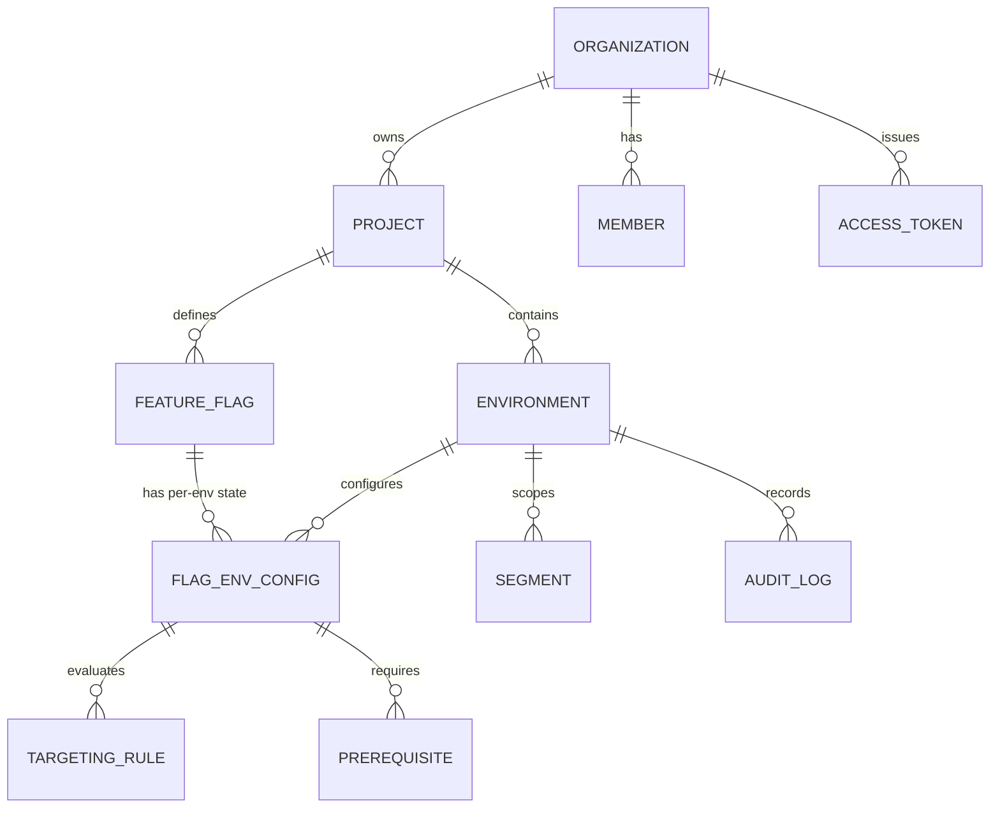

# Domain Model

## Core Entity Relationships



## Key Entities

### 1. Organization, Project & Environment

- **Organization**: Top-level tenant (`id`, `slug`, `name`, `createdAt`).
- **Project**: Scopes flag definitions (`id`, `orgId`, `key`, `name`, `defaultClientSideAvailability`).
- **Environment**: Independent runtime stage (`id`, `projectId`, `key`, `name`, `color`, `sdkKeyHash`, `mobileKey`, `clientSideId`, `requireComments`, `confirmChanges`, `revision`).
  - Each environment maintains a **monotonically increasing `revision`** (or per-flag/segment `version`) used to order streaming patches and prevent stale overwrites.

### 2. Feature Flag & Per-Environment Config

A flag's **definition** (key, variation type, variations) is shared at the Project level, while its **targeting state** is isolated per Environment:

- **Flag Definition (Project-scoped)**:
  - `key`: Unique immutable slug within the project (e.g., `new-checkout-flow`)
  - `kind`: `boolean` | `string` | `number` | `json`
  - `variations`: Ordered array of `{ id, value, name, description }`
  - `temporary`: Boolean indicating short-lived release flag vs permanent ops toggle
  - `clientSideAvailability`: `{ usingEnvironmentId, usingMobileKey }`
  - `tags`, `maintainerId`, `archived`, `deprecated`
- **Flag Environment Config (Environment-scoped)**:
  - `on`: Boolean kill switch
  - `version`: Monotonically increasing integer incremented on every mutation
  - `salt`: Random string used in consistent percentage rollout hashing
  - `offVariation`: Index into `variations` returned when `on == false` or prerequisite fails
  - `prerequisites`: Ordered list of `{ flagKey, variationIndex }`
  - `targets`: Per-variation explicit context key allowlists (`{ contextKind, values[], variationIndex }`)
  - `rules`: Ordered list of `{ id, clauses[], variationOrRollout, trackEvents }`
  - `fallthrough`: `{ variationIndex | rollout }`
  - `trackEvents`, `trackEventsFallthrough`, `debugEventsUntilDate`

### 3. Multi-Context Model

Following modern LaunchDarkly semantics, evaluation inputs are typed **Contexts** rather than flat user objects:

```json
{
  "kind": "multi",
  "user": {
    "key": "usr_123",
    "email": "ada@example.com",
    "plan": "enterprise",
    "_meta": {
      "privateAttributes": ["email"]
    }
  },
  "organization": {
    "key": "org_42",
    "region": "eu-west",
    "tier": "gold"
  }
}
```

Single contexts omit `"kind": "multi"` and specify `"kind": "user"` (or any custom kind) directly at the top level.

### 4. Segment

- **Standard Segment**: Embedded in the environment ruleset (`included[]`, `excluded[]`, `rules[]`, `version`, `salt`).
- **Big Segment (P1)**: For targeting lists with 100k+ keys; stores metadata in the main payload and checks membership out-of-band via Redis/persistent store so streaming payloads stay small.

## Open Questions for Planning

- Should `variations` be mutable in place (with stable `variationId` UUIDs) or append-only with soft-delete to preserve historical analytics integrity?
- Should flag rules live as normalized relational tables, versioned JSONB documents in Postgres, or a hybrid? (Track in ADR-0002.)
