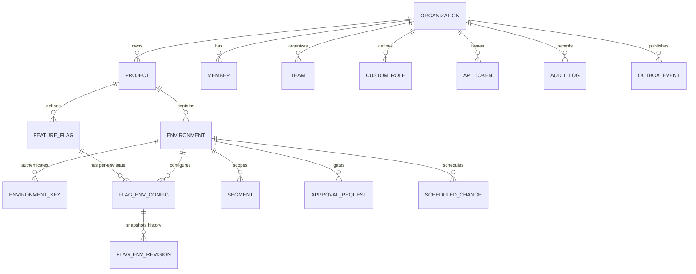

# Domain Model (Finalized Specification)

Per [ADR-0002](../../architecture/adrs/0002-primary-datastore-and-schema.md), Skotos uses **PostgreSQL 16+** with a **hybrid relational + versioned `JSONB`** schema in `crates/skotos-storage` backed by strongly typed Rust domain structs in `crates/skotos-domain`.

## Core Entity Relationships



## Storage Tables & Schema Split

### 1. Relational Control Hierarchy

- `organizations` (`id`, `slug`, `name`, `external_auth_org_id`, `plan_tier`, `created_at`)
- `members` (`id`, `org_id`, `external_subject_id`, `email`, `display_name`, `role`, `created_at`)
- `projects` (`id`, `org_id`, `key`, `name`, `default_client_side_availability`, `created_at`)
- `environments` (`id`, `project_id`, `key`, `name`, `color`, `client_side_id`, `require_comments`, `confirm_changes`, `revision`, `created_at`)
- `environment_keys` (`id`, `env_id`, `kind` [`sdk` | `mobile`], `key_prefix`, `key_hash`, `expires_at`, `created_at`)
- `flags` (`id`, `project_id`, `key`, `name`, `description`, `kind` [`boolean` | `string` | `number` | `json`], `variations_jsonb`, `temporary`, `client_side_availability_jsonb`, `tags`, `maintainer_id`, `archived`, `created_at`)

### 2. Versioned Runtime Configs (`JSONB`)

- `flag_env_configs`:
  - Primary key: `(flag_id, env_id)`
  - Columns: `version` (BIGINT, monotonic), `on` (BOOLEAN), `salt` (TEXT), `config_jsonb` (contains `offVariation`, `prerequisites`, `targets`, `rules`, `fallthrough`, `trackEvents`, `trackEventsFallthrough`, `debugEventsUntilDate`), `updated_at`.
  - Variations keep stable UUIDs (`variation.id`) inside `flags.variations_jsonb` so renaming/reordering variations preserves historical analytics integrity.
- `flag_env_revisions`:
  - Append-only snapshot of every `(flag_id, env_id, version)` with `config_jsonb`, `instructions_jsonb`, `actor_id`, `comment`, `created_at` — enables instant one-click version restore and structured history diffs.
- `segments`:
  - `(id, env_id, key, name, kind [standard | big | synced], version, salt, segment_jsonb, updated_at)`.

### 3. Transactional Outbox, Audit & Scheduling

- `audit_logs`: Partitioned by `created_at` (monthly); stores `org_id`, `project_id`, `env_id`, `resource_type`, `resource_key`, `actor_id`, `comment`, `instructions_jsonb`, `before_jsonb`, `after_jsonb`.
- `outbox_events`: `(id, org_id, env_id, event_type, payload_jsonb, created_at, published_at)` — consumed atomically via `FOR UPDATE SKIP LOCKED` by the snapshot compiler & NATS publisher worker.
- `scheduled_changes` & `approval_requests`: Store validated semantic instruction arrays (`instructions_jsonb`) so scheduled and approved edits execute through the exact same transactional patch engine.

## Canonical Multi-Context Model

```json
{
  "kind": "multi",
  "user": {
    "key": "usr_123",
    "email": "ada@example.com",
    "plan": "enterprise",
    "_meta": {
      "privateAttributes": ["email"]
    }
  },
  "organization": {
    "key": "org_42",
    "region": "eu-west",
    "tier": "gold"
  }
}
```

Single contexts specify `"kind": "user"` (or any custom kind) directly at the top level.
