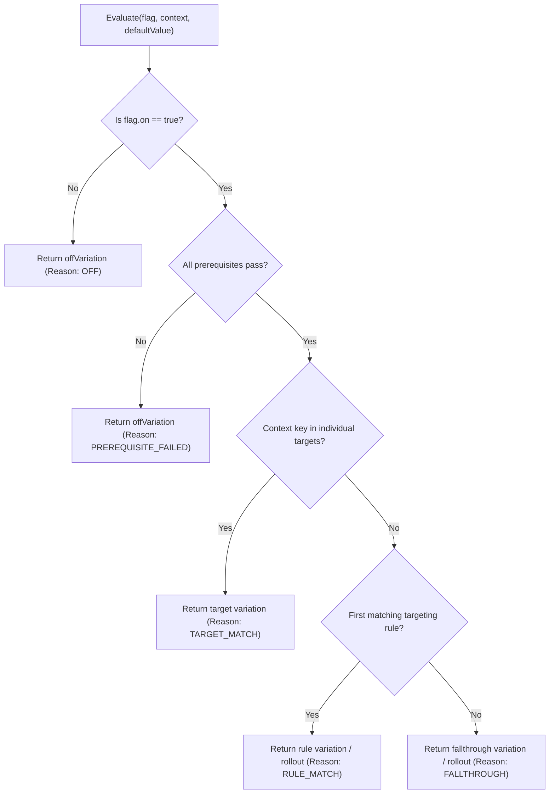

# Evaluation Engine Semantics

The evaluation engine is the heart of Skotos. **Every server-side SDK, the client-side delivery tier, and the Relay Proxy must produce byte-for-byte identical evaluation outputs for any `(flag, segments, context)` input.**

## Evaluation Pipeline Order

### Detailed Step Rules

1. **Flag Existence & Type Check**:
   - If the flag does not exist, return `defaultValue` with `Reason: ERROR (FLAG_NOT_FOUND)`.
   - If the resolved variation's JSON type does not match the caller's typed getter (e.g., `boolVariation` on a string flag), return `defaultValue` with `Reason: ERROR (WRONG_TYPE)`.
2. **Targeting Kill Switch (`flag.on`)**:
   - If `false`, immediately return `offVariation` with `Reason: OFF`.
3. **Prerequisites**:
   - Evaluate each prerequisite flag in order (with cycle-detection guard at runtime in addition to write-time DAG validation).
   - If a prerequisite is missing, `off`, or evaluates to a different variation index than required, abort and return `offVariation` with `Reason: PREREQUISITE_FAILED (prerequisiteKey)`.
4. **Individual Targets**:
   - Match by `(contextKind, key)` against each target entry. Return matched variation with `Reason: TARGET_MATCH`.
5. **Targeting Rules**:
   - Evaluate rules sequentially; within each rule, all `clauses` must match (`AND`).
   - Within a single clause, attribute values (or arrays of attribute values) are matched against `clause.values` (`OR`), then inverted if `clause.negate == true`.
   - First matching rule resolves either a fixed `variationIndex` or a percentage `rollout` and returns `Reason: RULE_MATCH (ruleIndex, ruleId)`.
6. **Fallthrough**:
   - Resolves the default `variationIndex` or percentage `rollout` and returns `Reason: FALLTHROUGH`.

## Clause Operators

| Category                  | Operators                                                          |
| ------------------------- | ------------------------------------------------------------------ |
| **Equality & Membership** | `in` (exact match across string/number/bool)                       |
| **String**                | `startsWith`, `endsWith`, `contains`, `matches` (RE2-safe regex)   |
| **Numeric**               | `lessThan`, `lessThanOrEqual`, `greaterThan`, `greaterThanOrEqual` |
| **Date / Time**           | `before`, `after` (RFC 3339 timestamps & epoch ms)                 |
| **Semantic Version**      | `semverEqual`, `semverLessThan`, `semverGreaterThan`               |
| **Segment**               | `segmentMatch` (references segment key in environment store)       |

_Attribute references_ support JSON-pointer-like nested paths (e.g., `/address/country`) scoped to `clause.contextKind`.

## Deterministic Percentage Rollout (Bucketing)

To ensure consistent assignment across restarts, processes, and SDK languages:

1. Extract the bucketing key from the specified `contextKind` and `bucketBy` attribute (default: `key`).
   - If the context does not contain that `contextKind`, fall back to the first variation (or unassigned behavior — must be strictly specified in golden tests).
2. Compute hash input:
   - Standard rollout: `"{flagKey}.{salt}.{bucketValue}"` (plus optional `".{secondary}"` if supported).
   - Experimentation / custom seed: `"{seed}.{bucketValue}"`.
3. Hash with **SHA-1** (take the first 15 hex characters -> 60-bit unsigned integer `h`) and normalize:
   - `bucket = (h / 0xFFFFFFFFFFFFFFF) * 100000` (floating point in `[0, 100000)`, or exact integer arithmetic scaled to `100000` basis points — 0.001% precision).
4. Walk rollout `variations` accumulating `weight` (sum = `100000`); select the first variation where `bucket < cumulativeWeight`.

## Cross-SDK Parity: Golden Test Suite

Before implementing any second SDK or language port, maintain a language-agnostic `spec/evaluation-tests/` fixture suite (JSON files containing flags, segments, contexts, and expected `{ value, variationIndex, reason }`) executed in CI by every engine implementation.

## Open Questions for Planning

- Should we write one canonical evaluation core in Rust/WASM or Go and bind/port to other languages, or maintain small idiomatic pure-language engines validated by the golden test suite? (Track in ADR-0004.)
- Should regex operator `matches` strictly enforce linear-time RE2 semantics to prevent ReDoS?
