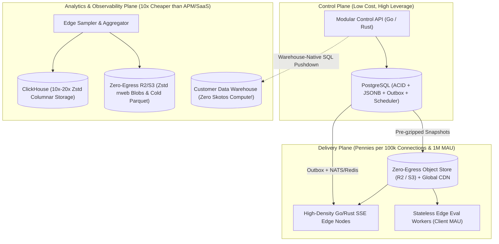

# LaunchDarkly Full Feature Catalog & Skotos Cost-Effective Architecture Strategy

This document catalogs the complete product surface LaunchDarkly offers across **CodeControl**, **AgentControl**, **Experimentation**, **Observability**, **Release Autopilot**, and **Enterprise Governance**, and defines how **Skotos** will build full feature parity on a **radically more cost-effective architecture** so we can undercut LaunchDarkly's pricing by 5x–10x while maintaining strong gross margins.

---

## 1. Why LaunchDarkly Is Expensive (Our Pricing Wedge)

Understanding LaunchDarkly's billing meters shows exactly where customers feel pain and where architecture directly creates pricing power:

| Billing Meter / Paywall                           | LaunchDarkly Model                                                                                        | Customer Pain Point                                                                     | Skotos Cost-Effective Strategy                                                                                                             |
| ------------------------------------------------- | --------------------------------------------------------------------------------------------------------- | --------------------------------------------------------------------------------------- | ------------------------------------------------------------------------------------------------------------------------------------------ |
| **Service Connections (SCs)**                     | 5 free, then `~$10–$12/mo` _per connected server SDK replica_ (including dev/staging)                     | Microservices & Kubernetes autoscaling explode the bill even with tiny traffic          | High-density Go/Rust SSE edge nodes (~100k–250k idle sockets per small VM -> `< $0.001`/SC COGS) + free open-source Relay Proxy            |
| **Client-Side MAU**                               | 1K free, then `~$8.33–$10/mo` per 1K MAU                                                                  | Consumer web/mobile apps with 500K MAU pay `$4,000–$5,000/mo` just for flag fetches     | Zero-egress object-storage snapshots (Cloudflare R2 / S3 + CDN) + Edge Worker evaluation + ETag/client caching (`< $0.05` per 1K MAU COGS) |
| **Enterprise Governance Paywall**                 | Audit logs, SSO/SAML, SCIM, custom RBAC, approvals, scheduling, workflows, code refs locked to Enterprise | Startups & mid-market teams forced into `$20k–$100k+/yr` contracts for basic compliance | Effectively `$0` marginal infra cost in PostgreSQL -> include in low-cost Pro/Team tiers                                                   |
| **Observability (Replays, Logs, Traces, Errors)** | Replays `~$3/1K`, Logs/Traces `~$1.25–$1.50/1M`, Errors `~$0.25–$0.30/1K`                                 | High-volume telemetry costs scale faster than core flag usage                           | ClickHouse columnar storage (10x–20x Zstd compression) + rrweb replays stored directly in zero-egress R2/S3 object storage                 |
| **AI Runs (AgentControl)**                        | 5K free, then `$5/1K` runs (online evals count as 2 runs)                                                 | Expensive tax on every LLM invocation & eval                                            | BYOK (Bring Your Own LLM Key) + local SDK config evaluation (`$0` per prompt eval) + lightweight trace ingestion                           |

---

## 2. Complete LaunchDarkly Feature Catalog & Skotos Cost Blueprint

### Pillar A: Core Feature Flags & Targeting

| #   | Feature                                               | LaunchDarkly Capability                                                                                                                                                                | Skotos Cost-Effective Implementation                                                                           | Target Phase |
| --- | ----------------------------------------------------- | -------------------------------------------------------------------------------------------------------------------------------------------------------------------------------------- | -------------------------------------------------------------------------------------------------------------- | ------------ |
| A1  | **Boolean & Multivariate Flags**                      | Unlimited boolean, string, number, and JSON flags with named variations                                                                                                                | Single PostgreSQL `flags` + `flag_env_configs` (`JSONB`) with monotonic integer versioning                     | Phase 1      |
| A2  | **Multi-Project & Multi-Environment Isolation**       | Unlimited projects & environments (`dev`, `staging`, `prod`, custom) with color coding and independent SDK keys                                                                        | Row-level tenant/project/env scoping in Postgres; environment-keyed pre-serialized snapshots                   | Phase 1      |
| A3  | **Multi-Context Evaluation Model**                    | Typed contexts (`user`, `organization`, `device`, custom kinds) and multi-contexts evaluated simultaneously                                                                            | Canonical JSON Context schema baked into v1 evaluation engine & all SDKs                                       | Phase 1      |
| A4  | **Targeting Rules & Clause Operators**                | Ordered rules with AND clauses (`in`, `startsWith`, `endsWith`, `contains`, `matches` regex, numeric, date `before`/`after`, semver, `segmentMatch`, negation, nested attribute paths) | Pure deterministic evaluation engine with RE2 linear-time regex + language-agnostic golden test suite          | Phase 1      |
| A5  | **Individual Context Targeting**                      | Pin specific context keys per variation regardless of rules                                                                                                                            | Indexed key lookup map per context kind inside compiled flag payload                                           | Phase 1      |
| A6  | **Deterministic Percentage Rollouts**                 | Weighted rollouts (0.001% precision), configurable `bucketBy` attribute, custom seeds, sticky bucketing                                                                                | SHA-1/Murmur consistent hashing in SDKs (zero server calls required for server SDKs)                           | Phase 1      |
| A7  | **Flag Prerequisites**                                | Require upstream flag(s) to evaluate to specific variations before proceeding                                                                                                          | Write-time DAG cycle validation in Control Plane + runtime depth guard in evaluator                            | Phase 2      |
| A8  | **Flag Templates & Naming Conventions**               | Reusable flag creation templates (release, kill switch, experiment, migration) & enforced key patterns                                                                                 | Lightweight project-level JSON schema templates validated on flag creation                                     | Phase 2      |
| A9  | **Flag Views, Tags, Maintainers & Custom Properties** | Organize flags by team/domain views, tags, maintainers, external links, and custom metadata                                                                                            | Standard relational metadata & GIN-indexed tags in Postgres (`$0` extra infra)                                 | Phase 2      |
| A10 | **Flag History & One-Click Version Restore**          | Inspect full historical revisions of a flag and roll back to any prior snapshot                                                                                                        | Append-only versioned config snapshots in Postgres; restore writes version `N+1` cleanly                       | Phase 1      |
| A11 | **Bulk Targeting & Environment Diff/Copy**            | Bulk-add targets (CSV/paste) and copy/promote flag targeting rules across environments                                                                                                 | Control Plane transactional batch patch + UI visual diff preview                                               | Phase 2      |
| A12 | **Flag Lifecycle & Archive Checks**                   | Temporary vs permanent flags, stale detection, archive readiness checks (evaluations + code refs), restore archived flags                                                              | Driven by lightweight summary evaluation timestamps + CI code-ref extinction signals                           | Phase 2      |
| A13 | **Migration Flags (2, 4, and 6-Stage)**               | Phased database/service migrations (`off`, `dualwrite`, `shadow`, `live`, `rampdown`, `complete`) with consistency rate, p99 latency, and error rate tracking                          | Built on standard multivariate stage model + SDK migration helper middleware reporting compact summary metrics | Phase 4      |

---

### Pillar B: Segments & Audience Management

| #   | Feature                                      | LaunchDarkly Capability                                                                                                             | Skotos Cost-Effective Implementation                                                                                    | Target Phase |
| --- | -------------------------------------------- | ----------------------------------------------------------------------------------------------------------------------------------- | ----------------------------------------------------------------------------------------------------------------------- | ------------ |
| B1  | **Rule-Based Segments**                      | Reusable dynamic targeting rules shared across flags in an environment                                                              | Embedded in environment ruleset snapshot; evaluated locally in SDKs                                                     | Phase 2      |
| B2  | **Small List-Based Segments**                | Explicit included/excluded context key lists (up to ~15K targets) streamed with ruleset                                             | Compact sorted/hashed list inside gzipped/zstd environment snapshot                                                     | Phase 2      |
| B3  | **Large List-Based Segments (Big Segments)** | Millions of static context keys without bloating SSE streaming payloads                                                             | Store compressed Roaring Bitmaps / hashed sets in R2/S3 + optional Redis/SQLite sync in Relay Proxy or persistent store | Phase 3      |
| B4  | **Synced Segments (External Audiences)**     | Sync cohorts from Amplitude, Fivetran/Census, Hightouch, RudderStack, Twilio Segment, Heap, Tealium, Zeotap                         | Generic delta-sync Webhook/Batch API + standard reverse-ETL connectors writing into the Big Segments store              | Phase 4      |
| B5  | **Scheduled Segment Changes**                | Schedule future additions/removals of contexts from segments                                                                        | Shared Postgres-backed job scheduler (`scheduled_changes` table) used for both flags and segments                       | Phase 3      |
| B6  | **Contexts Directory & Flag Audiences**      | Searchable catalog of discovered contexts, inspect which variation each context gets, filter audiences by attribute/variation/stage | Sampled/deduplicated context index in ClickHouse with configurable TTL (e.g., 30 days) to cap storage costs             | Phase 3      |

---

### Pillar C: Release Management, Progressive Delivery & Release Autopilot

| #   | Feature                                      | LaunchDarkly Capability                                                                                                                                                      | Skotos Cost-Effective Implementation                                                                                                    | Target Phase |
| --- | -------------------------------------------- | ---------------------------------------------------------------------------------------------------------------------------------------------------------------------------- | --------------------------------------------------------------------------------------------------------------------------------------- | ------------ |
| C1  | **Flag Scheduling**                          | Schedule one or more future targeting changes at exact timestamps                                                                                                            | Unified Postgres job queue with worker polling + audit logging (`$0` extra infrastructure)                                              | Phase 2      |
| C2  | **Flag Workflows (Multi-Step Automation)**   | Visual multi-step workflows combining scheduled time delays, rollouts, and approval gates                                                                                    | Deterministic state machine stored in Postgres (`workflow_runs` + `workflow_steps`)                                                     | Phase 3      |
| C3  | **Progressive Rollouts**                     | Automatically ramp percentage exposure over time (e.g., 5% -> 25% -> 50% -> 100%)                                                                                            | Built directly on the Flag Workflow state machine                                                                                       | Phase 3      |
| C4  | **Release Pipelines & Release Plans**        | Standardize reusable multi-environment release paths (dev -> staging -> prod phases, deploy signals, approval gates) across all flags                                        | Declarative pipeline templates in Postgres + deploy-signal webhook endpoint (GitHub/CI)                                                 | Phase 3      |
| C5  | **Release Policies & Health Checks**         | Define org/project guardrails and required checks before advancing release phases                                                                                            | Policy evaluator attached to pipeline phase transitions                                                                                 | Phase 4      |
| C6  | **Guarded Rollouts (Release Guardian)**      | Monitor guardrail metrics (errors, latency, custom KPIs) + SRM checks at each rollout step; notify or auto-rollback on regression                                            | Periodic ClickHouse/Observability metric evaluator per active guarded rollout; auto-emits revert patch via Control Plane                | Phase 4      |
| C7  | **Multi-Phase / Audience-Based Releases**    | Roll out sequentially across risk-tiered audiences (internal -> beta -> 10% -> GA) with regression gates between phases                                                      | Combines Segments + Release Pipelines + Guarded Rollout metric checks                                                                   | Phase 4      |
| C8  | **Flag Triggers (External APM Rollbacks)**   | Unguessable rate-limited webhook URLs allowing Datadog, Dynatrace, Honeycomb, New Relic, Splunk, or generic monitors to toggle flags off/on                                  | Stateless HMAC/token-verified trigger endpoint with per-trigger Redis/in-memory rate limiter                                            | Phase 2      |
| C9  | **Adaptive Triggers**                        | Automatically switch a flag or AI config to a safe variation when an internal/observability metric breaches a threshold                                                      | Powered by the same Alerting + Guarded Rollout threshold evaluator                                                                      | Phase 4      |
| C10 | **Applications & App Version Tracking**      | Track releases across mobile/desktop app versions and prevent incompatible flags from targeting old builds                                                                   | Standard `ld_application` / `skotos_app` context metadata + version semver targeting                                                    | Phase 3      |
| C11 | **Release Dashboard & Engineering Insights** | Project-wide view of active releases, DORA metrics (deploy frequency, lead time, MTTR), and flag health/debt                                                                 | Aggregated from CI deploy webhooks + Git PR events + flag lifecycle history in ClickHouse/Postgres                                      | Phase 4      |
| C12 | **AI Release Autopilot (GitHub App)**        | PR change classifier (risk score), auto-flagging PRs, auto-release from merge, auto-cleanup PRs for stale flags, auto-archival, auto-fix PRs on rollback, chat Release Agent | GitHub App + BYOK LLM provider (customer supplies OpenAI/Anthropic/Gemini key or pays near-pass-through cost) — zero fixed GPU overhead | Phase 6      |

---

### Pillar D: Experimentation & Measurement

| #   | Feature                                                | LaunchDarkly Capability                                                                                                                 | Skotos Cost-Effective Implementation                                                                                                                               | Target Phase |
| --- | ------------------------------------------------------ | --------------------------------------------------------------------------------------------------------------------------------------- | ------------------------------------------------------------------------------------------------------------------------------------------------------------------ | ------------ |
| D1  | **A/B & A/B/n Full-Stack Experiments**                 | Run experiments on any feature flag or AI config across web, mobile, and backend services                                               | Reuses consistent rollout bucketing with explicit experiment iteration keys & exposure event logging                                                               | Phase 4      |
| D2  | **Frequentist & Bayesian Statistical Engines**         | Choice of Frequentist (p-values, confidence intervals, 1/2-sided tests) or Bayesian (probability to beat control, credible intervals)   | Fast, stateless statistical computation module (Go/Rust/Python) operating on pre-aggregated sufficient statistics (`n`, `sum`, `sum_sq`) instead of raw row scans! | Phase 4      |
| D3  | **CUPED Variance Reduction**                           | Pre-experiment covariate adjustment to achieve statistical significance faster with smaller sample sizes                                | Pre-experiment window covariance computed once per metric in SQL (ClickHouse or customer warehouse)                                                                | Phase 5      |
| D4  | **Sequential Testing**                                 | Always-valid p-values / confidence sequences allowing continuous peeking without inflating false positives                              | Pure math layer (mSPRT / group sequential boundaries) over the same sufficient statistics (`$0` extra infra)                                                       | Phase 5      |
| D5  | **Sample Ratio Mismatch (SRM) & A/A Validity Testing** | Automatic chi-square detection of traffic-split bias and built-in A/A test support                                                      | Computed automatically on every results refresh from exposure counts                                                                                               | Phase 4      |
| D6  | **Multi-Armed Bandits (Dynamic Allocation)**           | Thompson Sampling / UCB dynamically shifting traffic toward winning variations                                                          | Scheduled bandit weight updater reading recent ClickHouse/warehouse aggregates and publishing rollout patches                                                      | Phase 5      |
| D7  | **Flexible Metrics & Metric Groups**                   | Click, pageview, numeric, binary conversion, custom events, funnel metric groups, measurement windows, and reusable metric groups       | Declarative metric definitions compiled into parameterized ClickHouse or warehouse SQL templates                                                                   | Phase 4      |
| D8  | **Warehouse-Native Experimentation**                   | Compute experiments directly inside Snowflake, BigQuery, Redshift, Databricks, or Postgres using custom SQL metrics & assignment tables | **Huge COGS win**: executes parameterized SQL inside the _customer's_ warehouse; Skotos stores only summary results and metadata                                   | Phase 5      |
| D9  | **Mutual Exclusion & Layered Experiments**             | Prevent overlapping experiments from polluting each other via orthogonal hash layers/salts                                              | Pure hashing namespace (`layerKey` + `layerSalt`) in the evaluation engine — zero runtime infra cost                                                               | Phase 4      |
| D10 | **Global Holdouts**                                    | Exclude 1–5% of audience from all (or scoped) experiments over 1–3 months to measure cumulative program lift                            | Top-level holdout evaluation layer checked prior to experiment assignment                                                                                          | Phase 5      |
| D11 | **Audience Filtering & Experiment Approvals**          | Slice results by context attributes (country, plan, device) and require approvals before launching/stopping experiments                 | Dimension rollups in ClickHouse + shared Approval Workflow engine                                                                                                  | Phase 5      |

---

### Pillar E: AgentControl / AI Configs & Evaluations

| #   | Feature                                                 | LaunchDarkly Capability                                                                                                                                      | Skotos Cost-Effective Implementation                                                                                                                  | Target Phase |
| --- | ------------------------------------------------------- | ------------------------------------------------------------------------------------------------------------------------------------------------------------ | ----------------------------------------------------------------------------------------------------------------------------------------------------- | ------------ |
| E1  | **AI Configs — Completion Mode**                        | Runtime-managed prompts (system/user/assistant messages), model selection, temperature, max tokens, custom parameters, and fallback chains without redeploys | Built directly on the Flag Delivery Plane! AI Configs are specialized typed JSON flags streamed via the exact same ultra-cheap SSE/CDN infrastructure | Phase 5      |
| E2  | **AI Configs — Agent Mode & Agent Graphs**              | Multi-step agent instructions, persona configs, and visual/declarative multi-agent orchestration graphs                                                      | Versioned structured JSON config payloads delivered via the same flag ruleset stream                                                                  | Phase 5      |
| E3  | **Prompt Snippets & Tools Library**                     | Reusable shared prompt fragments and versioned function/tool schemas composed across configs                                                                 | Resolved at publish time in Control Plane into the compiled snapshot so SDK evaluation stays `< 1 ms`                                                 | Phase 5      |
| E4  | **Multi-Provider & Agent Framework Support**            | OpenAI, Anthropic, Google Gemini, AWS Bedrock, Azure OpenAI, local/OpenAI-compatible models; LangChain, Vercel AI SDK, OpenAI Agents SDK, CrewAI             | Thin provider-agnostic AI SDK wrapper mapping Skotos config JSON to provider request payloads                                                         | Phase 5      |
| E5  | **Interactive Prompt Playground**                       | Side-by-side prompt/model comparison and live test runs inside the UI                                                                                        | Executes via customer's BYOK provider credentials directly from stateless worker                                                                      | Phase 5      |
| E6  | **Datasets & Offline Batch Evaluations**                | Curated input/expected-output test datasets run in batch against candidate prompt/model versions                                                             | Async worker pool executing parallel evals against customer BYOK keys; results stored in Postgres/ClickHouse                                          | Phase 6      |
| E7  | **Online Evaluations (LLM-as-a-Judge & Custom Judges)** | Score live sampled production LLM responses using built-in or custom judge configs; feed scores into Guarded Rollouts & Experiments                          | Sampled async ingestion -> background judge queue (BYOK) -> numeric score written to ClickHouse metric table                                          | Phase 6      |
| E8  | **AI Guardrails, Blocklists & PII Redaction**           | Input/output regex/keyword blocklists, topic guardrails, and automated PII scrubbing                                                                         | Lightweight local regex/Aho-Corasick/NER rules in SDK & ingestion edge before traces hit storage                                                      | Phase 5      |
| E9  | **AI Insights & LLM Observability**                     | Token usage, latency (TTFT / total), estimated dollar cost, error rates, and full prompt/completion traces per config variation                              | OpenTelemetry GenAI semantic convention spans ingested into shared ClickHouse traces table                                                            | Phase 5      |

---

### Pillar F: Observability & Feature-Level Telemetry

| #   | Feature                                      | LaunchDarkly Capability                                                                                                    | Skotos Cost-Effective Implementation                                                                                                                                                                        | Target Phase |
| --- | -------------------------------------------- | -------------------------------------------------------------------------------------------------------------------------- | ----------------------------------------------------------------------------------------------------------------------------------------------------------------------------------------------------------- | ------------ |
| F1  | **Flag-Scoped Feature Monitoring**           | Automatic per-variation charts of errors, latency, logs, traces, and sessions right on the flag page                       | Tag all OTel spans, logs, errors, and replays with active `flag.key` + `flag.variation` attributes; slice directly in ClickHouse                                                                            | Phase 4      |
| F2  | **Application Logs (OTel + SDK)**            | High-volume structured log ingestion, full-text/attribute search, and live tail correlated with flag changes               | OpenTelemetry HTTP/gRPC collector -> ClickHouse with Zstd compression, bloom-filter indexes, and tiered TTL -> S3/R2 cold archive                                                                           | Phase 5      |
| F3  | **Distributed Traces (OTel)**                | End-to-end service traces, waterfall flamegraphs, and latency percentiles                                                  | Native OTLP ingestion into ClickHouse traces table (10x cheaper than commercial APM storage)                                                                                                                | Phase 5      |
| F4  | **Error Monitoring & Grouping**              | Exception/crash capture, source-map stack trace symbolication, fingerprinting, and regression tracking per flag variation  | Fingerprinted error groups in Postgres/ClickHouse; source maps stored cheaply in R2/S3                                                                                                                      | Phase 5      |
| F5  | **Session Replays (Web & Mobile)**           | DOM/screen recordings linked to flag variations, errors, console logs, and network events                                  | Open-source `rrweb` capture -> Zstd-compressed chunks uploaded directly to **zero-egress R2/S3** via presigned URLs; only lightweight session metadata lives in ClickHouse (`< $0.05` per 1K replays COGS!) | Phase 6      |
| F6  | **Ingestion Filter & Sampling Rules**        | Ordered include/exclude and percentage sampling rules for logs, traces, errors, and sessions                               | Evaluated at the Go/Rust ingestion edge _before_ writing to ClickHouse so customers control volume & we minimize storage/CPU                                                                                | Phase 5      |
| F7  | **Custom Observability Dashboards & Alerts** | Configurable charts + constant threshold & anomaly detection alerts routed to Slack/PagerDuty/Webhooks                     | ClickHouse materialized views for hot rollups + lightweight alert evaluation scheduler                                                                                                                      | Phase 5      |
| F8  | **AI Auto-Remediation Agent (Vega-style)**   | Embedded AI debugger correlating alerts, logs, traces, errors, and recent flag changes; can suggest or open GitHub fix PRs | Read-only & Agent modes powered by MCP tools over Skotos observability APIs + customer BYOK LLM                                                                                                             | Phase 6      |

---

### Pillar G: SDK Ecosystem, Edge & Delivery Infrastructure

| #   | Feature                                                | LaunchDarkly Capability                                                                                                                                        | Skotos Cost-Effective Implementation                                                                                                                                                               | Target Phase |
| --- | ------------------------------------------------------ | -------------------------------------------------------------------------------------------------------------------------------------------------------------- | -------------------------------------------------------------------------------------------------------------------------------------------------------------------------------------------------- | ------------ |
| G1  | **Server-Side SDKs**                                   | Node/TS, Go, Python, Java, .NET, Ruby, PHP, Rust, C++, Erlang/Elixir                                                                                           | Start with **TS/Node, Go, Python, Java** in Phases 2–3; expand via shared **Rust/C-ABI or spec-driven thin wrappers** validated against our golden evaluation test suite to slash maintenance cost | Phase 2–4    |
| G2  | **Client-Side & Mobile SDKs**                          | Browser JS, React, Next.js, Vue, Angular, iOS (Swift), Android (Kotlin), React Native, Flutter, Electron                                                       | Start with **Browser JS + React** (Phase 2), then **iOS/Android/Flutter/React Native** (Phase 3–4)                                                                                                 | Phase 2–4    |
| G3  | **Edge SDKs**                                          | Cloudflare Workers, Fastly Compute, Vercel Edge Config, AWS Lambda@Edge, Akamai EdgeWorkers                                                                    | Direct reads from our R2/KV/Edge-synced snapshot payloads with zero origin roundtrips                                                                                                              | Phase 3      |
| G4  | **OpenFeature Providers**                              | Vendor-neutral OpenFeature standard providers across major languages                                                                                           | First-class OpenFeature wrappers around every Skotos SDK from day one (reduces switching friction _away_ from LaunchDarkly!)                                                                       | Phase 2      |
| G5  | **Streaming (SSE), Polling (ETag) & Client Eval APIs** | Sub-200ms global streaming (`put`/`patch`/`delete`), conditional polling, and secure client `evalx`/`REPORT`                                                   | High-concurrency Go/Rust SSE edge + R2/CDN pre-gzipped snapshots + stateless edge eval                                                                                                             | Phase 2      |
| G6  | **Relay Proxy (Proxy & Daemon Modes + Auto-Config)**   | Self-hosted VPC proxy multiplexing thousands of SDK connections, local Redis/DynamoDB/Consul caching, offline file mode, and auto-config for all projects/envs | Single lightweight static Go/Rust binary + Docker image (`< 30 MB` RAM baseline) distributed free & open-source                                                                                    | Phase 3      |
| G7  | **Persistent Feature Stores**                          | Redis, DynamoDB, Consul backing stores for SDKs and Big Segments                                                                                               | Pluggable store interface (`FeatureStore` + `BigSegmentStore`) in server SDKs and Relay Proxy                                                                                                      | Phase 3      |
| G8  | **Offline, File Bootstrap & TestData Modes**           | Zero-network local dev, static JSON bootstrap, and deterministic unit-test flag mocking                                                                        | Built into every SDK core from v1                                                                                                                                                                  | Phase 2      |
| G9  | **Real-Time Live Events Debugger**                     | Stream live flag evaluation events in the dashboard to debug targeting rules                                                                                   | Ephemeral per-environment pub/sub tap (only active while UI debugger tab is open — zero storage cost!)                                                                                             | Phase 3      |

---

### Pillar H: Code References, Developer Tools & Agentic Access

| #   | Feature                                        | LaunchDarkly Capability                                                                                                                             | Skotos Cost-Effective Implementation                                                                                            | Target Phase |
| --- | ---------------------------------------------- | --------------------------------------------------------------------------------------------------------------------------------------------------- | ------------------------------------------------------------------------------------------------------------------------------- | ------------ |
| H1  | **Code References & Extinction Detection**     | Scan repos in CI (GitHub Actions, GitLab CI, Bitbucket, CircleCI) to show exact file/line usages of flags and detect when all code refs are deleted | Open-source fast Rust/Go CLI (`skotos-code-refs`) running on the _customer's_ CI compute; posts tiny JSON diff to Control Plane | Phase 3      |
| H2  | **IDE Extensions**                             | VS Code & JetBrains plugins showing flag status, targeting hover tooltips, and autocomplete                                                         | Thin extensions calling Skotos Control Plane REST API + local CLI                                                               | Phase 4      |
| H3  | **CLI & Terraform Provider**                   | Full IaC management of projects, environments, flags, segments, roles, and webhooks + interactive terminal CLI                                      | Auto-generated Go SDK from OpenAPI 3.1 spec powering both `skotos-cli` and `terraform-provider-skotos`                          | Phase 3      |
| H4  | **MCP Server (Hosted & Local) & Agent Skills** | Model Context Protocol tools letting AI coding agents create/toggle flags, inspect targeting, query observability, and safely clean up stale flags  | Lightweight MCP server wrapping Control Plane + Observability APIs with OAuth/API-token RBAC scoping                            | Phase 3–4    |

---

### Pillar I: Governance, Security, Compliance & Data Export

| #   | Feature                                        | LaunchDarkly Capability                                                                                                                                    | Skotos Cost-Effective Implementation                                                                                           | Target Phase |
| --- | ---------------------------------------------- | ---------------------------------------------------------------------------------------------------------------------------------------------------------- | ------------------------------------------------------------------------------------------------------------------------------ | ------------ |
| I1  | **Built-In & Custom RBAC Policies**            | Fine-grained resource-path allow/deny policy engine (`proj/*:env/prod:flag/*`) + Teams                                                                     | Fast in-process policy evaluator backed by cached Postgres role documents (`$0` extra infra)                                   | Phase 3      |
| I2  | **Approval Requests & Mandatory Approvals**    | Peer review before applying flag/segment/experiment changes (1–5 reviewers, team reviewers, environment/tag enforcement, ServiceNow/custom approval hooks) | Transactional `approval_requests` storing semantic patch payloads; applied atomically upon approval                            | Phase 3      |
| I3  | **Immutable Audit Log (Unlimited History)**    | Complete tamper-evident timeline of every mutation with actor, timestamp, comment, and structured before/after diff                                        | Partitioned append-only Postgres table (archived cheaply to Parquet in R2/S3 after 1 year -> unlimited retention for pennies!) | Phase 1–3    |
| I4  | **SSO (SAML 2.0 / OIDC), 2FA & SCIM**          | Enterprise identity federation, MFA, and automated user/team provisioning from Okta/Entra ID/Google                                                        | Standard OIDC/SAML2 + SCIM 2.0 handlers in Control Plane (no Enterprise extortion pricing!)                                    | Phase 3      |
| I5  | **Key Isolation & Zero-Downtime Key Rotation** | Separate SDK Key, Mobile Key, Client-Side ID, and scoped API Tokens with overlapping grace-period rotation                                                 | Dual-active hashed keys with `expires_at` timestamp in env auth cache                                                          | Phase 1–2    |
| I6  | **Private Attributes & PII Protection**        | Never transmit sensitive context attributes off the customer's server/device                                                                               | Enforced strictly inside every SDK prior to telemetry serialization + edge scrubber                                            | Phase 2      |
| I7  | **Real-Time Data Export**                      | Stream raw evaluation/identify/custom events to AWS Kinesis, GCP Pub/Sub, Azure Event Hubs, Snowflake, Segment, mParticle, or S3                           | Async fanout consumer reading event queue and batch-writing to customer sinks (customer pays destination storage)              | Phase 4      |
| I8  | **Data Residency & Compliance Readiness**      | US / EU regional deployments, encryption at rest/in transit, SOC 2 / ISO / HIPAA / self-hosted VPC option                                                  | Clean stateless + Postgres/ClickHouse/R2 deployment via Helm/Terraform makes EU/US regions & customer-VPC self-hosting trivial | Phase 4–5    |

---

### Pillar J: Integrations & Ecosystem

| #   | Feature                                                                                | LaunchDarkly Capability                                                                               | Skotos Cost-Effective Implementation                                                 | Target Phase |
| --- | -------------------------------------------------------------------------------------- | ----------------------------------------------------------------------------------------------------- | ------------------------------------------------------------------------------------ | ------------ |
| J1  | **Outbound Signed Webhooks**                                                           | Real-time HMAC-SHA256 webhooks on flag, segment, project, or approval events with filtering & retries | Transactional outbox -> async webhook delivery worker with exponential backoff & DLQ | Phase 2      |
| J2  | **ChatOps (Slack & Microsoft Teams)**                                                  | Flag change notifications, slash commands to inspect/toggle flags, and interactive approval buttons   | Thin webhook/bot service calling Control Plane API                                   | Phase 3      |
| J3  | **Issue Trackers (Jira, Linear, Trello)**                                              | Link flags to tickets, see flag rollout state inside issues, auto-update ticket status                | Bi-directional webhook & OAuth app integrations                                      | Phase 3      |
| J4  | **APM & Incident Tools (Datadog, Honeycomb, New Relic, Dynatrace, Splunk, PagerDuty)** | Send flag change annotations to APM timelines + receive alert triggers to auto-rollback flags         | Outbound event annotations via Webhook templates + inbound Flag Trigger adapters     | Phase 3      |
| J5  | **Cloud & Deploy Platforms (GitHub, GitLab, Vercel, AWS Marketplace)**                 | PR previews, deploy signal hooks, Edge Config sync, marketplace billing                               | Standard OAuth/App integrations + Edge snapshot sync workers                         | Phase 3–4    |

---

## 3. Cost-Effective Architecture Principles (How We Sell Cheap)

To achieve **80%+ gross margins even at 5x–10x lower prices than LaunchDarkly**, every architectural decision in Skotos must obey seven core principles:

### The 7 Cost-Engineering Levers

1. **Compiled-language Delivery Edge (Go or Rust, NOT Node/JVM for SSE)**:
   - Holding 100,000 idle TLS/SSE connections in Go/Rust uses ~500 MB–1 GB RAM (a single `$20–$40/mo` machine). That kills LaunchDarkly's `$10/mo per Service Connection` cost structure completely.
2. **Pre-Serialized Snapshots on Zero-Egress Storage + CDN**:
   - Whenever a flag mutates, compile & Zstd/Gzip-compress the environment ruleset **once** and upload to Cloudflare R2 (zero egress fees) / CDN. Reconnect storms and polling SDKs serve cached bytes at near-zero CPU and zero DB queries.
3. **Consolidate Control-Plane State in PostgreSQL**:
   - Flags, segments, RBAC policies, approvals, workflows, scheduled jobs, audit logs, and transactional outbox all live in one well-tuned Postgres database instead of paying for 6 different managed databases and message brokers in Phases 1–3.
4. **SDK-Side Summary Aggregation First**:
   - Never ship raw per-evaluation rows by default. SDKs aggregate millions of flag evaluations into tiny 5-second counter buckets, reducing ingestion bandwidth and storage by **1,000x–10,000x**.
5. **ClickHouse + Object Storage (R2/S3) for Analytics & Observability**:
   - Store logs, traces, errors, evaluation rollups, and experiment metrics in ClickHouse (high Zstd compression, blazing aggregations) with automated TTL tiering to Parquet on R2/S3. Store heavy Session Replay (`rrweb`) chunks directly in R2/S3 via presigned uploads.
6. **Warehouse-Native Experimentation & BYOK AI**:
   - Push heavy experiment joins directly onto the customer's existing Snowflake/BigQuery/Databricks/Postgres warehouse, and let customers bring their own LLM API keys for AgentControl evals and AI Release Autopilot — keeping our compute bill tiny while giving enterprises better data privacy!
7. **Zero-Cost Governance Differentiator + Open-Source Relay Proxy / OpenFeature**:
   - Features LaunchDarkly paywalls at `$50k+/yr` (SSO, SCIM, audit logs, approvals, custom RBAC, scheduling, code references) cost us almost nothing to run. Bundling them in affordable plans + supporting OpenFeature and LaunchDarkly-compatible migration importers makes switching effortless.

---

## 4. Phased Delivery Map (All Features, Sequenced for Momentum)

| Phase                                                                     | Focus                                   | Key Capabilities Shipped                                                |
| ------------------------------------------------------------------------- | --------------------------------------- | ----------------------------------------------------------------------- |
| **Phase 1 — Core Flag Engine & Control Plane**                            | Usable, fast flag management MVP        | A1–A6, A10, I3 (core), I5 (core), Management Dashboard + Rule Simulator |
| **Phase 2 — Real-Time Delivery, First SDKs & Core Automation**            | Production-grade flag delivery          | A7–A9, A11–A12, B1–B2, C1, C8, G1–G2 (TS/Go/React), G4–G5, G8, I6, J1   |
| **Phase 3 — Enterprise Governance, Relay Proxy & Scale**                  | Undercut LD Enterprise tiers            | B3, B5–B6, C2–C4, C10, G3, G6–G7, G9, H1, H3–H4, I1–I4, J2–J5           |
| **Phase 4 — Experimentation Core, Guarded Rollouts & Feature Monitoring** | Safe progressive delivery & A/B testing | A13, B4, C5–C7, C9, C11, D1–D2, D5, D7, D9, F1, H2, I7–I8               |
| **Phase 5 — Warehouse-Native, Full Observability & AgentControl Core**    | Complete modern LD parity               | D3–D4, D6, D8, D10–D11, E1–E5, E8–E9, F2–F4, F6–F7                      |
| **Phase 6 — Session Replay, AI Evals & Autonomous Release Autopilot**     | Full AI-era platform parity             | C12, E6–E7, F5, F8                                                      |
